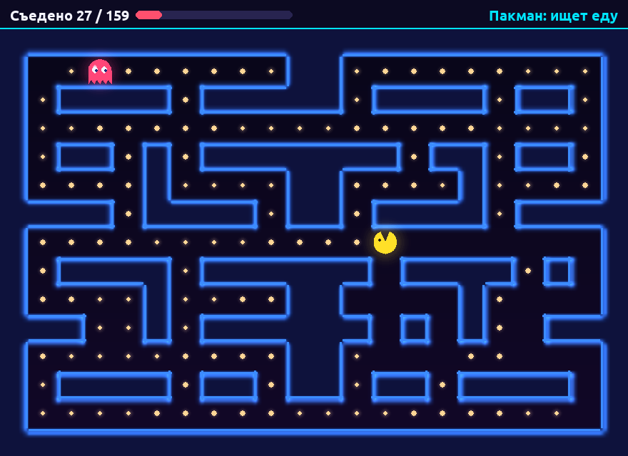
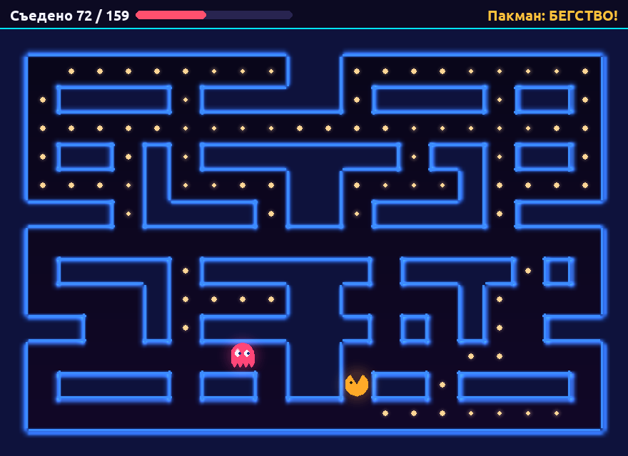
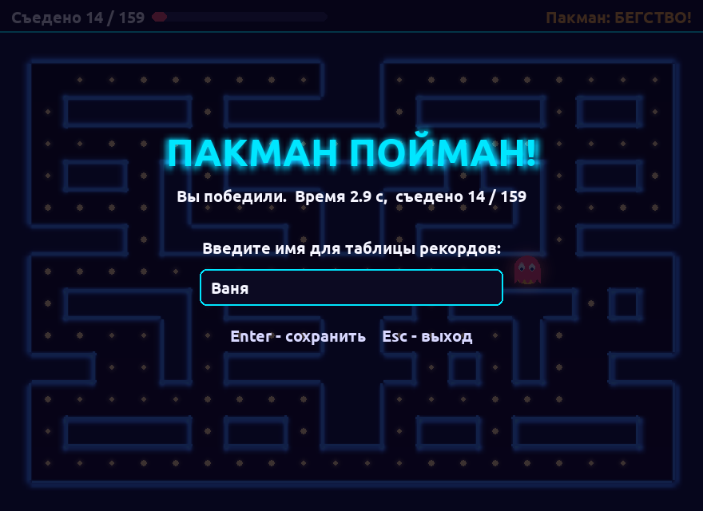
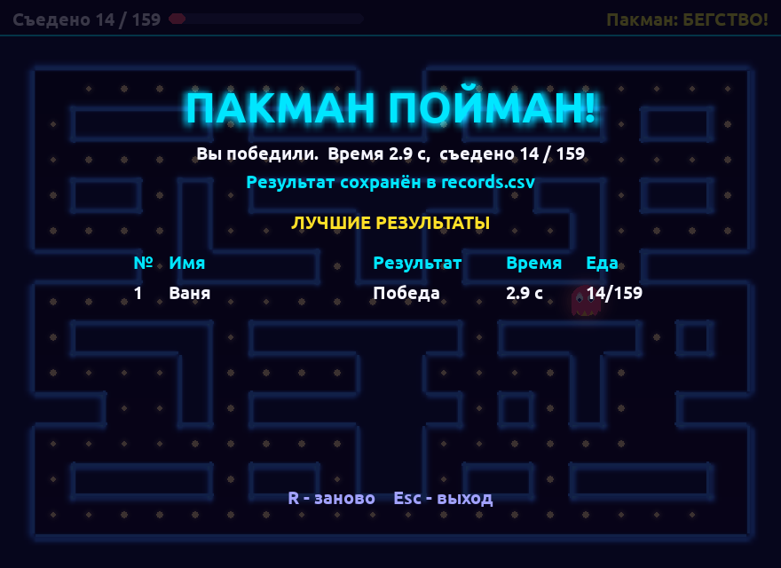
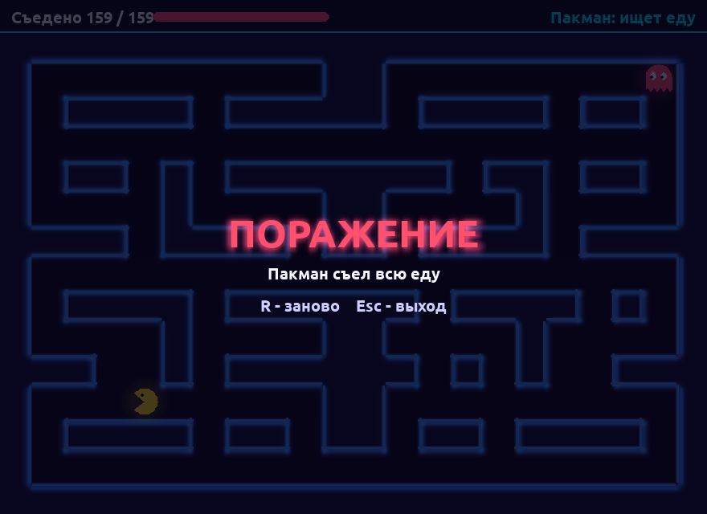

# Pac-Man Hunt — «Пакман: Охота в лабиринте»

Лабораторные работы № 1–3, **вариант 22**. Игра на Python + Pygame
и Telegram-бот аналитики к ней на aiogram.

- **ЛР 1** — сама игра: лабиринт, классы, коллизии, меню, HUD.
- **ЛР 2** — работа с файлами: уровень загружается из JSON с проверкой,
  события пишутся в лог-файл, результаты партий попадают в таблицу
  рекордов CSV (см. раздел [«ЛР 2: файлы данных»](#лр-2-файлы-данных)).
- **ЛР 3** — Telegram-бот «Аналитик Pac-Man Hunt» (папка `py_bot/`):
  таблица лидеров, личная статистика, ачивки и разбор лога по файлам
  игры (см. раздел [«ЛР 3: Telegram-бот»](#лр-3-telegram-бот)).

## Описание варианта

Классический «Пакман» наоборот: **игрок управляет Призраком**, а Пакманом
управляет искусственный интеллект. Пакман бегает по лабиринту и ест еду,
а задача игрока — поймать его раньше, чем он съест всё.

- Окно 880×640 (не меньше требуемых 800×600), 60 FPS.
- Лабиринт 22×15 клеток, еда лежит во всех проходах (159 точек).
- Логика пошаговая (по клеткам), а на экране персонажи двигаются плавно.
- Неоновое оформление: светящиеся стены, пульсирующая еда, анимированные
  персонажи, HUD с полоской прогресса, стартовый экран и экран конца игры.

## Правила

- **Игрок — Призрак.** Он стартует в левом верхнем углу, Пакман стартует
  в правом нижнем.
- **ИИ Пакмана** работает в двух режимах:
  - **Поиск еды** (`chase`): поиском в ширину (BFS) Пакман находит кратчайший
    путь до ближайшей еды и обходит клетку призрака.
  - **Бегство** (`flee`): включается, когда призрак ближе **5 клеток**.
    Пакман выбирает клетку, до которой успеет добраться раньше призрака
    и которая дальше всего от призрака, и идёт к ней.
  - **Гистерезис**: из бегства Пакман выходит, только когда призрак дальше
    **7 клеток**. Поэтому на границе в 5 клеток режимы не переключаются
    каждый шаг.
- Пакман делает шаг раз в 0,2 с. Если держать клавишу, призрак шагает
  раз в 170 мс, поэтому он чуть быстрее Пакмана.

### Победа и поражение

- **Победа** — Призрак оказался в одной клетке с Пакманом
  («ПАКМАН ПОЙМАН!»).
- **Поражение** — Пакман съел всю еду («ПОРАЖЕНИЕ»).

После конца партии игра просит ввести имя (можно кириллицей), сохраняет
результат в `records.csv` и показывает пять лучших результатов.

## Управление

| Клавиша                                 | Действие                     |
|-----------------------------------------|------------------------------|
| `W A S D` / стрелки / `Ц Ф Ы В` (рус.)  | движение Призрака            |
| `Пробел` (или `Enter`)                  | старт игры со стартового экрана |
| буквы, `Backspace`, `Enter`             | ввод имени после конца партии и сохранение |
| `R`                                     | начать заново                |
| `Esc`                                   | выход                        |

## Структура проекта

```
pacman-hunt/
├── main.py                 # точка входа: запускает игру
├── requirements.txt        # зависимости (pygame)
├── README.md               # этот файл (описание и отчёт)
├── .gitignore              # исключения для git (venv, __pycache__, логи, records.csv, .env и данные бота)
├── screenshots/            # скриншоты для README
├── game.log                # лог событий (создаётся при запуске, в git не попадает)
├── records.csv             # таблица рекордов (создаётся после первой партии)
└── pacman_hunt/            # пакет с кодом игры
    ├── __init__.py         # описание пакета и версия
    ├── constants.py        # константы: окно, цвета, скорости, пути к файлам, лабиринт по умолчанию
    ├── maze.py             # сетка лабиринта, set_maze, is_free и поиск в ширину (BFS)
    ├── effects.py          # графика: свечение, градиент, заголовки, фон, плавное движение
    ├── pacman.py           # класс Pacman: ИИ (поиск еды / бегство), шаги, отрисовка
    ├── ghost.py            # класс Ghost: персонаж игрока, движение, отрисовка
    ├── game.py             # класс Game: партия, HUD, ввод имени, рекорды, главный цикл
    ├── storage.py          # ЛР 2: загрузка и проверка уровня (JSON), рекорды (CSV)
    ├── logger.py           # ЛР 2: настройка логирования в файл
    └── data/
        └── level.json      # ЛР 2: описание уровня
└── py_bot/                 # ЛР 3: Telegram-бот аналитики
    ├── bot.py              # точка входа: хендлеры, FSM, экран, ошибки, фоновое слежение
    ├── analytics.py        # разбор и проверка CSV/лога, топ, статистика, ачивки
    ├── session.py          # JSON-сессии пользователей (sessions/<id>.json)
    ├── keyboards.py        # inline-клавиатуры
    ├── config.py           # токен из .env, ADMIN_IDS, пути, лимиты
    ├── requirements.txt    # aiogram, python-dotenv
    ├── .env.example        # шаблон настроек (сам .env в git не попадает)
    ├── sessions/           # сессии (в git не попадают)
    ├── data/scores.csv     # загруженные через бота результаты (в git не попадает)
    └── tests/              # тесты без настоящего токена (unittest)
```

## Установка и запуск (macOS)

Нужен Python 3.12 или новее.

```bash
cd путь/к/pacman-hunt
python3 -m venv .venv
source .venv/bin/activate
pip install -r requirements.txt
python main.py
```

На Windows окружение активируется командой `.venv\Scripts\activate`,
остальные шаги такие же.

## ЛР 2: файлы данных

Вся работа с файлами вынесена в два модуля: `storage.py` (JSON и CSV)
и `logger.py` (лог). Пути к файлам заданы в `constants.py` через
`pathlib` от расположения пакета, поэтому игра находит файлы, из какой
бы папки её ни запустили. Все файлы открываются через `with` и
с `encoding="utf-8"`.

| Файл | Формат | Кто пишет / читает | Зачем |
|------|--------|--------------------|-------|
| `pacman_hunt/data/level.json` | JSON | `storage.load_level` читает при старте | лабиринт, стартовые клетки, настройки ИИ |
| `game.log` | текст | `logger` дописывает (режим `"a"`) | журнал событий с временем |
| `records.csv` | CSV | `storage.save_result` дописывает, `storage.load_records` читает | таблица рекордов |

**Почему JSON и CSV.** Уровень — вложенная структура (матрица, объекты
героев с координатами и настройками), а JSON хранит вложенные списки и
словари и сразу превращается в них через `json.load`. Рекорды — плоская
таблица с одинаковыми столбцами, CSV для этого проще всего: файл
открывается в Excel/Numbers, а новая строка просто дописывается в конец.

### Файл уровня `level.json`

```json
{
  "name": "Классический лабиринт",
  "maze": [
    [1, 1, 1, 1, 1, 1, 1, 1, 1, 1, 1, 1, 1, 1, 1, 1, 1, 1, 1, 1, 1, 1],
    [1, 0, 0, 0, 0, 0, 0, 0, 0, 0, 1, 1, 0, 0, 0, 0, 0, 0, 0, 0, 0, 1],
    [1, 0, 1, 1, 1, 1, 0, 1, 1, 1, 1, 1, 0, 1, 1, 1, 1, 0, 1, 1, 0, 1],
    "... ещё 12 рядов по 22 клетки ..."
  ],
  "ghost": {
    "start": [1, 1]
  },
  "pacman": {
    "start": [20, 13],
    "delay": 0.2,
    "flee_dist": 5,
    "flee_exit": 7
  }
}
```

(строка `"... ещё 12 рядов ..."` здесь только для сокращения, в настоящем
файле все 15 рядов).

| Ключ | Тип | Значение |
|------|-----|----------|
| `name` | строка | название уровня (показывается в меню) |
| `maze` | 15 списков по 22 числа | `1` — стена, `0` — проход (еда кладётся во все проходы) |
| `ghost.start` | `[x, y]` | стартовая клетка призрака (игрока) |
| `pacman.start` | `[x, y]` | стартовая клетка Пакмана |
| `pacman.delay` | число, необяз. | секунд между шагами Пакмана (по умолчанию 0.2) |
| `pacman.flee_dist` | число, необяз. | призрак ближе — Пакман убегает (5) |
| `pacman.flee_exit` | число, необяз. | призрак дальше — Пакман снова ищет еду (7) |

Чтобы сделать свой уровень, достаточно поменять 0 и 1 в `maze` или
стартовые клетки — код трогать не нужно.

### Загрузка уровня и обработка ошибок

`load_level()` проверяет, что файл существует (`Path.exists()`), читает
его через `with open(...)` и `json.load`, а затем проверяет структуру
функцией `validate_level()`. Если что-то не так, программа не падает:
в лог пишется `WARNING` с причиной, а игра запускается с **уровнем по
умолчанию** (лабиринт из `constants.py`). В меню тогда видна красная
надпись «Файл уровня не загружен — используется уровень по умолчанию».

| Ситуация | Исключение | Что происходит |
|----------|-----------|----------------|
| файла нет | `FileNotFoundError` | уровень по умолчанию + WARNING в логе |
| сломан синтаксис JSON (лишняя запятая, нет скобки) | `json.JSONDecodeError` | то же, в логе номер строки и столбца ошибки |
| неверная структура (нет ключа, не 15×22, клетка не 0/1, старт в стене или за полем, герои в одной клетке, нет прохода от призрака к Пакману, `flee_exit < flee_dist`) | `LevelError` (наследник `ValueError`) | то же, в логе описание проблемы |
| нет прав, вместо файла папка, файл не в UTF-8 | `OSError`, `UnicodeDecodeError` | то же |

Валидация нужна, потому что JSON может быть синтаксически верным, но
бессмысленным для игры: например, если призрак стоит в стене, игра
«сломается» уже во время партии. Проверка при загрузке ловит такие
ошибки сразу и объясняет, что именно не так.

Размер лабиринта фиксирован (15×22), потому что от него зависит размер
окна 880×640.

### Лог `game.log`

Логгер настраивается в `logger.setup_logging()` (модуль `logging`,
`FileHandler` в режиме `"a"`), формат строки:
`%(asctime)s | %(levelname)s | %(message)s`. Записываются: запуск и выход,
результат загрузки уровня, начало партии и рестарт, **каждый шаг игрока**,
переход Пакмана в режим бегства и обратно (аналог «перехода противника
в состояние расследования»), каждые 25 % съеденной еды, победа или
поражение, сохранение результата. Если лог-файл открыть нельзя, лог
выводится в консоль.

```
2026-10-28 14:22:24 | INFO | ===== Запуск игры Pac-Man Hunt =====
2026-10-28 14:22:24 | INFO | Уровень «Классический лабиринт» загружен из level.json
2026-10-28 14:22:25 | INFO | Новая партия: уровень «Классический лабиринт», еды 159, призрак (1, 1), Пакман (20, 13)
2026-10-28 14:22:26 | INFO | Шаг игрока: призрак (1, 1) -> (2, 1)
2026-10-28 14:22:27 | INFO | Пакман (19, 7) заметил призрака (17, 3) (расстояние 4.5) -> режим БЕГСТВО
2026-10-28 14:22:27 | INFO | ПОБЕДА: призрак поймал Пакмана в клетке (16, 7) за 2.9 с, съедено 14/159
2026-10-28 14:22:28 | INFO | Результат сохранён в records.csv: Ваня, Победа, 2.9 с, съедено 14/159
2026-10-28 14:22:28 | INFO | Сохранение результата завершено (успех: True)
2026-10-28 14:22:28 | INFO | Выход из игры
```

Пример предупреждения, когда файл уровня повреждён:

```
2026-10-28 14:23:37 | WARNING | Уровень не загружен: ошибка JSON в level.json, строка 2, столбец 1: Expecting value. Используется уровень по умолчанию
```

### Таблица рекордов `records.csv`

После конца партии игрок вводит имя прямо в окне игры (события
`TEXTINPUT`, поэтому работает русская раскладка; `Backspace` стирает,
`Enter` сохраняет; пустое имя заменяется на «Игрок»). `save_result()`
дописывает строку через `csv.DictWriter` в режиме `"a"`. При первом
запуске файла нет, поэтому сначала пишется строка заголовка. Ошибка
записи (`OSError`) не роняет игру: она попадает в лог, а на экране
появляется сообщение «Не удалось сохранить результат».

```csv
Дата,Имя,Результат,Время,Съедено,Всего
2026-10-28 14:22:28,Ваня,Победа,2.9,14,159
2026-10-28 14:25:35,Rick,Поражение,105.3,159,159
```

| Столбец | Значение |
|---------|----------|
| Дата | дата и время конца партии |
| Имя | имя игрока |
| Результат | `Победа` (Пакман пойман) или `Поражение` (еда кончилась) |
| Время | длительность партии в секундах |
| Съедено | сколько еды успел съесть Пакман |
| Всего | сколько еды было на уровне |

На экране конца `load_records()` читает таблицу через `csv.DictReader`
(повреждённые строки пропускаются), а `top_records()` выбирает пять
лучших: сначала победы, где Пакман съел меньше еды (при равенстве —
быстрее), потом поражения, где игрок продержался дольше.

### Где используется `try / except / else / finally`

- `storage.load_level` — `try` читает и проверяет файл; несколько `except`
  ловят разные ошибки; `else` (выполняется только без ошибок) пишет
  в лог «уровень загружен» и возвращает его.
- `storage.save_result` — `try` пишет строку в CSV; `except OSError` —
  ошибка записи; `else` — запись в лог об успехе; `finally` выполняется
  всегда и отмечает в логе, что сохранение завершено.

### Проверка (этап 4)

- Нормальный запуск: уровень загружается из `level.json`, поведение игры
  такое же, как в ЛР 1 (сравнивались позиции героев покадрово).
- Файл уровня удалён, повреждён JSON, неверная структура (14 рядов,
  клетка `2`, старт в стене, одинаковые старты, нет прохода и др.) —
  во всех случаях запускается уровень по умолчанию и в логе есть WARNING.
- CSV: первая партия создаёт файл с заголовком, следующие дописывают
  строки, заголовок не повторяется; запись в недоступную папку не роняет
  игру.
- Лог: в файле есть строки всех событий в формате `время | уровень | текст`.

## ЛР 3: Telegram-бот

Бот **«Аналитик Pac-Man Hunt»** (папка `py_bot/`, библиотека aiogram 3)
работает с теми же файлами, что пишет игра в ЛР 2: `records.csv` и
`game.log` в корне проекта.

### Зачем бот, если есть игра

Бот — **сервис вокруг игры**, а не её копия: сыграть в Пакмана в
Telegram нельзя, и это не нужно. Игра на экране конца показывает только
пять лучших результатов одного компьютера и не хранит ничего о
конкретном игроке. Бот делает то, чего в игре нет:

- **общая таблица лидеров** — игроки присылают свои `records.csv`, бот
  проверяет строки, убирает дубликаты и собирает общий рейтинг (порядок
  тот же, что у топ-5 в игре: сначала победы, где Пакман съел меньше,
  при равенстве — быстрее; потом поражения, где игрок продержался дольше);
- **личная статистика** по имени игрока: партии, процент побед, лучшая
  поимка, среднее «съедено», место в рейтинге, последняя партия;
- **ачивки**, которые считаются по истории партий;
- **разбор `game.log`**: сколько раз Пакман уходил в бегство, сколько
  шагов делает игрок за партию, сколько партий брошено недоигранными;
- **уведомления подписчикам** о новых результатах — из загруженных
  файлов и сразу после партии в игре (бот раз в 10 секунд проверяет,
  не изменился ли `records.csv`).

### Архитектура

| Модуль | Что делает |
|--------|-----------|
| `bot.py` | хендлеры команд, кнопок и файлов; FSM; «один экран»; глобальный обработчик ошибок; фоновое слежение за `records.csv`; запуск поллинга |
| `analytics.py` | чистые функции без Telegram: разбор и **проверка** CSV, слияние без дублей, таблица лидеров, статистика, ачивки, разбор лога |
| `session.py` | сессия пользователя в `py_bot/sessions/<user_id>.json` |
| `keyboards.py` | все inline-клавиатуры |
| `config.py` | токен и `ADMIN_IDS` из `py_bot/.env`, пути через `pathlib` от папки бота, лимиты |

**Состояния (FSM):** `MENU` — главное меню, `UPLOAD` — бот ждёт файл,
`WAIT_NAME` — ждёт имя игрока, `BROADCAST` — ждёт текст рассылки (только
админ). Текстовые хендлеры привязаны к состоянию через `StateFilter`,
поэтому, например, файл, присланный не в режиме загрузки, не
обрабатывается. `/start` и `/help` зарегистрированы первыми и без
фильтра состояния — ими можно выйти из любого режима. Состояние дублируется
в JSON-сессию.

**Один экран.** Бот не засыпает чат сообщениями: нажатие кнопки
редактирует то же сообщение (`bot.edit_message_text`). Ошибка
«message is not modified» (повторное нажатие) игнорируется, а если
сообщение удалено или слишком старое, бот присылает новое и запоминает
его id в сессии. `callback.answer()` обёрнут в `try/except`, частые
нажатия гасятся (антидребезг 0,7 с), а в группе нельзя нажимать
кнопки чужого экрана.

**Проверка загружаемых результатов.** Сначала проверяются размер (до
1 МБ), расширение и MIME — ещё до скачивания. Файл читается в память
(`BytesIO`), декодируется как `utf-8-sig` (файл из Excel с BOM тоже
подходит), разбирается в отдельном потоке (`asyncio.to_thread`), чтобы
не тормозить бота. Каждая строка проверяется по правилам игры:

- правильный заголовок `Дата,Имя,Результат,Время,Съедено,Всего`;
- дата в формате игры и не из будущего; имя 1–16 печатных символов;
- результат — `Победа` или `Поражение`; время от 0 до 3600 с;
- поражение бывает только когда съедена **вся** еда, победа — когда нет;
- «античит»: Пакман ест не больше одной точки за шаг (0,2 с), поэтому
  время не может быть меньше `съедено × 0,1 с`.

Плохие строки отклоняются с указанием номера и причины, хорошие
дописываются в `py_bot/data/scores.csv` без дублей. Бот при этом не
падает ни на каком файле.

**Безопасность и надёжность:** токен только в `py_bot/.env` (в git не
попадает, как и сессии, база и логи); все имена из файлов экранируются
`html.escape`, таблицы выводятся в `<pre>`; админ-команды проверяют
`ADMIN_IDS` и в команде, и в кнопке; при сбое Telegram запросы
повторяются один раз; любое необработанное исключение ловит `@dp.errors`
— оно пишется в лог, а пользователь видит «Временный сбой. Попробуйте
/start». Работа бота пишется в `py_bot/bot_flight.log` с временем.

### Запуск

1. В Telegram откройте **@BotFather**, отправьте `/newbot`, введите имя и
   username бота (должен кончаться на `bot`). BotFather пришлёт токен
   вида `123456789:AA...`.
2. Скопируйте шаблон и впишите токен:
   ```bash
   cp py_bot/.env.example py_bot/.env
   ```
   ```
   BOT_TOKEN=123456789:AA...ваш токен...
   ADMIN_IDS=        # свой id (узнать: команда /whoami в боте), через запятую
   ```
3. Установите зависимости и запустите **из корня проекта**:
   ```bash
   pip install -r py_bot/requirements.txt
   python py_bot/bot.py
   ```
   Пути заданы от папки `py_bot` через `pathlib`, поэтому бот запускается
   из любой папки. Если токена нет или он неверный, бот сразу
   завершается с понятным сообщением, что исправить.
4. Остановка — `Ctrl+C`.

### Кнопки и команды

| Кнопка | Что делает |
|--------|-----------|
| 🏆 Топ игроков | таблица лидеров по 10 строк, листается «◀️ ▶️», ваша строка отмечена |
| 📊 Моя статистика | статистика по вашему имени (если имени нет — бот спросит) |
| 🎖 Ачивки | полученные и ещё не полученные ачивки |
| 📜 Статистика по логу | разбор `game.log`: партии, побеги Пакмана, шаги, уровни логов |
| 📤 Загрузить результаты | режим `UPLOAD`: прислать `records.csv` (или `game.log` для разбора) |
| ✏️ Указать имя | режим `WAIT_NAME`: имя, под которым вы играете в игре |
| 🔔 Подписка / 🔕 | включить или выключить уведомления о новых результатах |
| ⬅️ Назад / ✖️ Отмена | вернуться в меню из любого режима |
| 🛠 Лог бота, 📣 Рассылка | видны только админам |

Команды: `/start`, `/help`, `/menu` (`/cancel`), `/top`,
`/stats [имя]`, `/whoami`. Админ: `/log [N]` — последние N строк лога
бота (до 50), `/broadcast` — рассылка подписчикам.

Ачивки: 👻 Первая охота (первая победа), ⚡ Молния (поймать быстрее
20 с), 🍽 Голодный Пакман (поймать до 25 % еды), 🧊 Ни крошки (Пакман
съел ≤ 5 точек), 🔥 Серия (3 победы подряд), 🎯 Охотник (5 побед),
🏅 Ветеран лабиринта (10 партий), 🐢 Терпение (партия дольше 2 минут).

### Пример сессии `py_bot/sessions/123456789.json`

```json
{
  "state": "MENU",
  "name": "Ваня",
  "subscribed": true,
  "screen_message_id": 42,
  "screen_chat_id": 123456789,
  "uploads": 1,
  "last_click": 0.0,
  "user_id": 123456789,
  "created": "2026-10-28 14:41:35"
}
```

`screen_message_id` — id «экрана», который бот редактирует;
`last_click` — время последнего нажатия (антидребезг). Сессия
сохраняется атомарно (сначала во временный файл, потом
`os.replace`), а повреждённый файл не роняет бота — создаётся новая
сессия.

### Пример файла для загрузки

Это обычный `records.csv`, который пишет игра:

```csv
Дата,Имя,Результат,Время,Съедено,Всего
2026-10-28 14:22:28,Ваня,Победа,12.4,9,159
2026-10-28 14:25:35,Rick,Поражение,105.3,159,159
2026-10-28 14:30:02,Ваня,Победа,18.0,31,159
```

Ответ бота: «Добавлено новых партий: 3», а если в файле были плохие
строки — «Отклонено строк: N» и причины, например
`Строка 5: поражение, но Пакман съел не всю еду`.

### Тесты

```bash
cd py_bot
python -m unittest discover -s tests -t .
```

40 тестов, настоящий токен и сеть не нужны:
`test_analytics.py` и `test_session.py` проверяют разбор, проверку,
рейтинг, ачивки, лог и сессии; `test_bot.py` подаёт апдейты в
диспетчер (`dp.feed_update`) с поддельной сессией Telegram и проверяет
диалоги: меню, редактирование одного экрана, ввод имени, загрузку
хорошего и битого файла, уведомления, права админа, изоляцию сессий,
отмену, обработчик ошибок и запуск без токена. Отдельный тест сверяет,
что порядок таблицы лидеров бота совпадает с `top_records()` игры.

## Скриншоты

**Стартовый экран**


**Игра: Пакман ищет еду**



**Пакман в режиме бегства** (призрак ближе 5 клеток, Пакман стал оранжевым,
в HUD мигает «БЕГСТВО!»)



**Ввод имени после конца партии**



**Победа: результат сохранён, таблица лучших результатов**



**Поражение: Пакман съел всю еду**



**Файл уровня не найден — запущен уровень по умолчанию**


