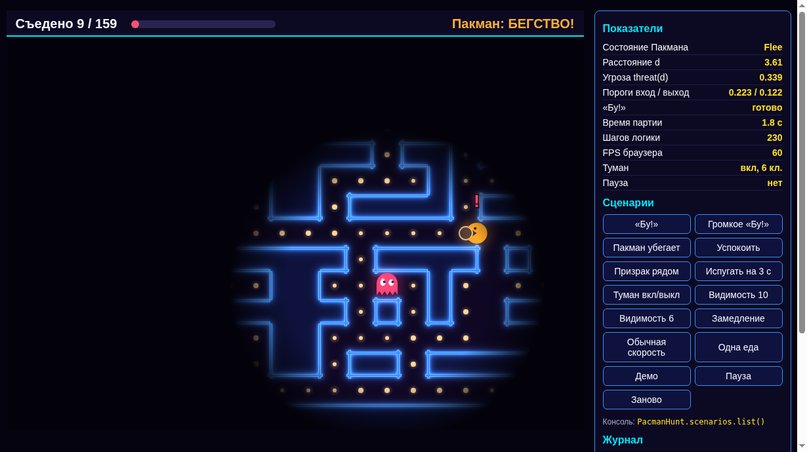
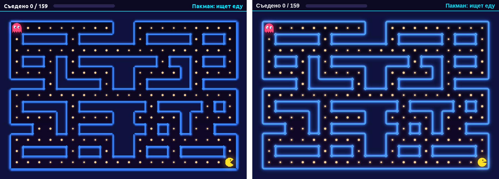
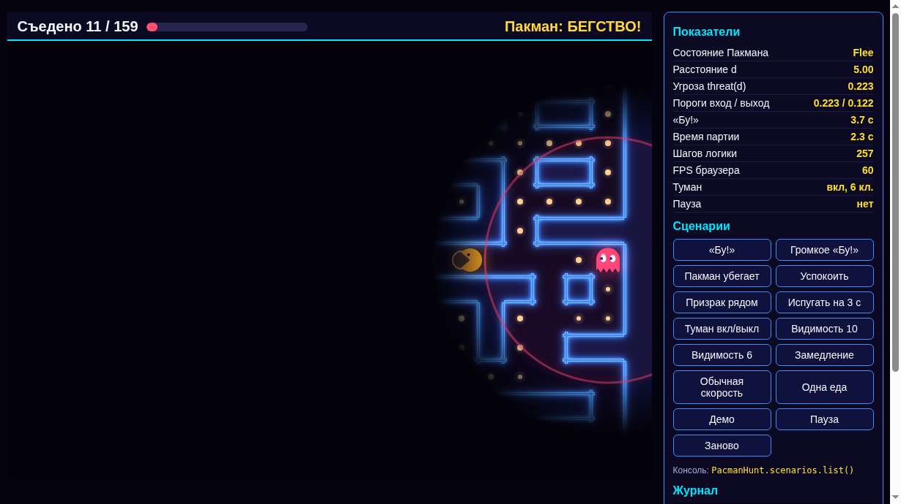
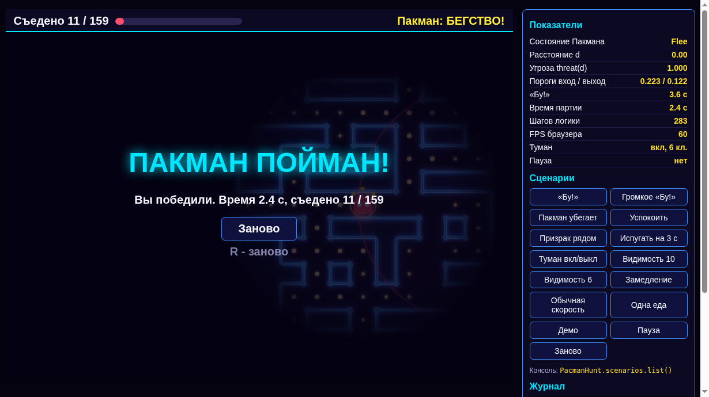

# ЛР 5: веб-виджет Pac-Man Hunt на Canvas

Браузерная версия игры поверх ядра из ЛР 4. Логика (`Game`, `Pacman`, `Ghost`,
`Effect`, `GameField`) **импортируется** из `../pacman_js/js/` через ES-модули и не
копируется. Виджет только читает клавиши, шагает ядро с фиксированным шагом и рисует.
Картинка повторяет Pygame-версию: те же цвета из `constants.py`, неоновые стены,
пульсирующая еда, Пакман с открывающимся ртом, призрак с волнистым подолом и глазами,
верхняя панель «Съедено N / 159» с полоской и надписью режима.

## Запуск

Нужен Node.js 18+. Зависимостей нет.

```bash
cd pacman_widget
npm start      # Виджет Pac-Man Hunt: http://127.0.0.1:8080/pacman_widget/
npm test       # самопроверка цикла, сценариев и индикаторов (31 проверка)
```

Сервер `server.js` раздаёт **корень репозитория**, потому что виджет импортирует
`../pacman_js/js/*.js` и читает `../pacman_hunt/data/level.json`. Разрешены только папки
`pacman_widget/`, `pacman_js/` и `pacman_hunt/data/`, адрес — только `127.0.0.1`
(файл `py_bot/.env` с токеном наружу не отдаётся). Порт: `PORT=3000 npm start`.

Открыть `index.html` двойным щелчком нельзя: браузер не загружает ES-модули по `file://`.
Другой вариант сервера — из корня репозитория:
`python3 -m http.server 8000 --bind 127.0.0.1` и адрес `http://127.0.0.1:8000/pacman_widget/`.

## Управление

| Клавиша | Действие |
|---|---|
| Пробел / Enter | начать игру (на стартовом экране) |
| Стрелки или WASD (на русской раскладке тоже) | двигать призрака |
| Пробел | «Бу!» — волна, пугает Пакмана (кулдаун 4 с) |
| F | туман вкл/выкл |
| P | пауза |
| R | новая партия (и на экране результата) |

## Структура

```
pacman_widget/
├── index.html        # canvas 880×600, панель HUD, экраны меню/результата, кнопки сценариев
├── css/style.css     # тёмная тема, сетка «холст + панель», HUD как в Pygame
├── js/
│   ├── widget.js     # главный модуль: Widget (шаг логики, связка частей), запуск, window.PacmanHunt
│   ├── loop.js       # FixedStepLoop: requestAnimationFrame + фиксированный шаг + накопитель
│   ├── input.js      # Input: объект-флаги клавиш, preventDefault
│   ├── renderer.js   # Renderer: фон, туман, еда, эффекты, Пакман, призрак, значки
│   ├── indicators.js # Indicators: «!», «?», «♪», «!?» над Пакманом при реакциях
│   ├── hud.js        # Hud: показатели через textContent готовых элементов
│   ├── palette.js    # цвета из constants.py, радиус видимости
│   └── scenarios.js  # реестр вызываемых сценариев
├── selftest.js       # проверки без браузера (Node)
├── server.js         # статический сервер (корень = репозиторий)
└── package.json      # "type": "module", npm start / npm test
```

## Параметры цикла и отрисовки

| Параметр | Значение | Где |
|---|---|---|
| Фиксированный шаг логики `STEP_MS` | 1000 / 60 ≈ 16.67 мс (60 шагов/с) | `js/loop.js` |
| Защита от «прыжка» `MAX_DELTA_MS` | 100 мс (не больше 6 шагов за кадр) | `js/loop.js` |
| Шаг призрака при зажатой клавише | раз в 10 шагов ≈ 167 мс (в Pygame 170 мс) | `js/widget.js` |
| Шаг Пакмана | 0.2 с = 12 шагов логики (из `level.json`) | ядро `game.js` |
| Радиус видимости `VISION_CELLS` | 6 клеток = 240 px вокруг призрака | `js/palette.js` |
| Жизнь значка реакции | 1400 мс | `js/indicators.js` |
| Волна «Бу!» | радиус до 6×modifier клеток, 12 клеток/с, alpha = 1 − r/R | ядро `effect.js` |

Каждый кадр: `delta = min(now − last, 100)` → накопитель `+= delta × timeScale` →
пока накопитель ≥ 16.67 мс: шаг логики → отрисовка → `requestAnimationFrame`.

## Сценарии

Реестр — объект функций из `createScenarios(widget)` в `js/scenarios.js`. Три способа вызова:

1. **Кнопки** с атрибутом `data-scenario` (аргументы в `data-args`, например `data-args="[10]"`).
2. **Консоль браузера**: `PacmanHunt.scenarios.megaBoo(1.5)`, список — `PacmanHunt.scenarios.list()`.
3. **Из кода**: клавиши F/P/R вызывают `toggleFog`/`pause`/`restart`, сценарий `demo()` вызывает другие.

| Сценарий | Что делает |
|---|---|
| `boo()` | «Бу!» призрака (с кулдауном 4 с) |
| `megaBoo(modifier = 1.5)` | громкое «Бу!» без кулдауна |
| `scarePacman(ms = 2000)` | Пакман замирает на ms миллисекунд (звёздочки) |
| `forceFlee()` | Пакман сразу убегает (FLEE, значок «!») |
| `calm()` | Пакман успокаивается (CHASE) |
| `teleportGhost(x, y)` | призрак в клетку [x, y] (в стену нельзя) |
| `ghostNearPacman()` | призрак в 3 шагах от Пакмана — видно реакцию |
| `lastFood()` | оставить одну еду — проверить защиту от застревания |
| `toggleFog()` | туман вкл/выкл |
| `setVision(cells = 6)` | радиус видимости в клетках |
| `slowMotion(scale = 0.25)` | скорость времени (1 — норма) |
| `pacmanSpeed(delaySec = 0.2)` | пауза между шагами Пакмана |
| `pause()` | пауза / продолжить |
| `restart()` | новая партия |
| `demo()` | призрак рядом → громкое «Бу!» → туман выкл |
| `list()` | таблица всех сценариев в консоли |

## Модель и представление

* **Модель** (ядро ЛР 4, `pacman_js/js/`): позиции, состояния Пакмана, формула угрозы,
  волны `Effect` (их `radius` и `alpha`), кулдауны, победа/поражение.
* **Представление** (`renderer.js`, `hud.js`, `index.html`, `style.css`): только рисует
  то, что посчитала модель. Сценарии меняют модель и настройки, но ничего не рисуют.

## Скриншоты

Туман: виден круг радиусом 6 клеток вокруг призрака, над Пакманом «!» — он заметил призрака:



Слева — Pygame-игра (тот же `level.json`), справа — Canvas-виджет с выключенным туманом:



Громкое «Бу!» и экран результата:




